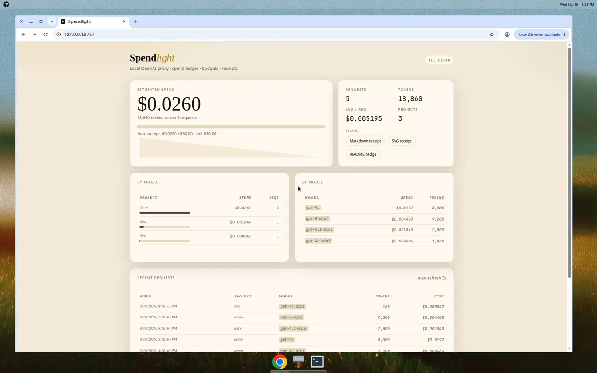
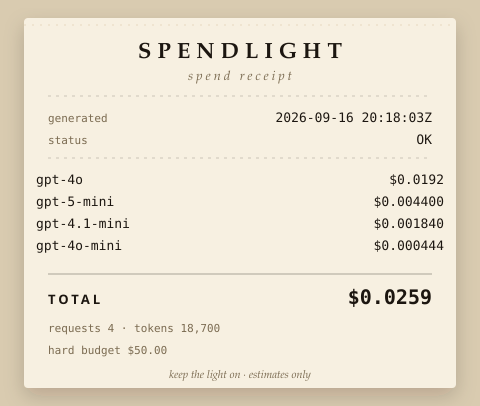

# Spendlight

Drop-in **OpenAI-compatible** reverse proxy for your laptop. Point any client at Spendlight instead of the provider, keep (or omit) your API key, and get a local spend ledger, soft/hard budgets, and shareable receipts.

Swap the base URL. That is the whole integration.

> **v1 is cost, budgets, and receipts only.** It is not a gateway, a tracer, or a billing system.



## What it is

A single Node process that:

1. Speaks an OpenAI-compatible `/v1` API. Chat completions, legacy completions, embeddings, and responses are priced into the ledger. Every other `/v1/*` path is forwarded and still stops at a hard budget, but it is not priced.
2. Forwards to any OpenAI-compatible upstream (`OPENAI_BASE_URL` + `OPENAI_API_KEY`).
3. Writes a spend ledger (model, tokens, estimated USD, project tag, timestamp, request id).
4. Warns on a **soft** budget and rejects further mutating `/v1` calls with **402** when a **hard** budget is hit.
5. Serves a dashboard at `/` and `/dashboard`, Markdown and SVG receipts, a README badge, `/api/summary`, and CSV and JSON ledger exports. `GET /health` returns `{ "ok": true, "service": "spendlight" }`.

## What it isn’t (v1 non-goals)

- Tracing, evals, or an observability suite
- Multi-provider routing, load balancing, or failover
- Auth on the dashboard — this is a **local** tool; bind to localhost
- Perfect, billing-grade invoices — costs are **estimates** from a local price table
- A public or shared-team proxy — do not put it on the internet

## Architecture

```
  OpenAI SDK / curl / app
           |
           |  baseURL = http://127.0.0.1:8787/v1
           v
  ┌──────────────────────────────────────────┐
  │              Spendlight                  │
  │  /                 local dashboard       │
  │  /api/export.csv   spend ledger CSV      │
  │  /api/export.json  spend ledger JSON     │
  │  /receipt.md .svg  shareable receipts    │
  │  /badge.svg        README badge          │
  │  /v1/*             reverse proxy         │
  │        │                                 │
  │        ├─ hard budget reserve (SQLite)   │
  │        │    soft → warning header        │
  │        │    hard → 402 on mutating /v1   │
  │        ├─ upstream fetch                 │
  │        └─ ledger settles the reservation │
  └──────────────────────────────────────────┘
           |                      |
           v                      v
   OpenAI-compatible API     SQLite (WAL)
   OPENAI_BASE_URL           SPENDLIGHT_DB
```

Pricing is a local table (sane OpenAI defaults, overridable in `spendlight.config.json`). Unknown models use a conservative fallback price. Costs are **estimates**, not provider invoices.

Tag traffic with `x-spendlight-project` (or `x-spendlight-tag`, `?project=`, or `spendlight_project` in the JSON body). That is the budget bucket. Tags are labels, not authentication.

## Install

Needs **Node 22.13+** (built-in `node:sqlite`). Pick one path.

### npx

```bash
export OPENAI_API_KEY=sk-...
npx --yes github:realvaleh/Spendlight
```

Then open [http://127.0.0.1:8787](http://127.0.0.1:8787).

### Docker Compose / `docker run`

```bash
export OPENAI_API_KEY=sk-...
docker compose up --build
```

Compose publishes **localhost only** (`127.0.0.1:8787`). Inside the container Spendlight still listens on `0.0.0.0` so the published port works. The image and Compose file healthcheck `GET /health` on port 8787.

```bash
docker build -t spendlight . && docker run --rm -p 127.0.0.1:8787:8787 \
  -e OPENAI_API_KEY \
  -e SPENDLIGHT_HARD_BUDGET_USD=25 \
  -v spendlight-data:/data spendlight
```

### Clone + npm

```bash
git clone https://github.com/realvaleh/Spendlight.git
cd Spendlight
cp .env.example .env          # set OPENAI_API_KEY
cp spendlight.config.example.json spendlight.config.json
npm install
npm start                     # http://127.0.0.1:8787
```

CLI flags: `spendlight --config ./spendlight.config.json --host 127.0.0.1 --port 8787 --db ./data/spendlight.db` (`-h` / `--help`, `-v` / `--version`).

## Quickstart

Once Spendlight is running, point a client at it and send one completion. The proxy injects `OPENAI_API_KEY` when the client omits `Authorization`.

```bash
export OPENAI_BASE_URL=http://127.0.0.1:8787/v1
# keep OPENAI_API_KEY as-is, or let Spendlight inject it

curl http://127.0.0.1:8787/v1/chat/completions \
  -H "content-type: application/json" \
  -H "x-spendlight-project: demo" \
  -d '{"model":"gpt-4o-mini","messages":[{"role":"user","content":"hi"}]}'
```

Open [http://127.0.0.1:8787](http://127.0.0.1:8787). You should see the `demo` request on the dashboard, a non-zero estimated spend, and links to receipts.

SDK-shaped equivalent:

```js
import OpenAI from "openai";

const openai = new OpenAI({
  baseURL: "http://127.0.0.1:8787/v1",
  apiKey: process.env.OPENAI_API_KEY, // or any placeholder if Spendlight holds the real key
  defaultHeaders: { "x-spendlight-project": "demo" },
});

await openai.chat.completions.create({
  model: "gpt-4o-mini",
  messages: [{ role: "user", content: "hi" }],
});
```

## Pricing

Costs are estimates from a local table, not a provider invoice. Each model has a USD price per 1,000,000 tokens:

```
uncached prompt × inputPerMillion
+ cached prompt × (cachedInputPerMillion, or inputPerMillion when that rate is unset)
+ completion × outputPerMillion
```

Cached tokens are capped at the prompt count, so one token is not billed twice. Chat completions read the cache count from `usage.prompt_tokens_details.cached_tokens` when that field is present. Prompt and completion counts accept `prompt_tokens` / `completion_tokens`, or `input_tokens` / `output_tokens`.

A model id uses an exact table row, or else the longest configured id that is a prefix of it. `gpt-4o-mini-2024-07-18` uses `gpt-4o-mini`, not the shorter `gpt-4o`. An id that matches nothing uses `fallbackPrice`: **5** input, **15** output, and **0.5** cached per million tokens. Override `fallbackPrice` in `spendlight.config.json` to change that.

`pricing` overrides one model at a time. A field you omit keeps the built-in rate. A model id that is not in the built-in table uses the fallback input and output rates for fields you omit, and has no separate cache rate unless you set `cachedInputPerMillion` (cached tokens are then billed at that model's input rate).

```bash
curl http://127.0.0.1:8787/v1/embeddings \
  -H "content-type: application/json" \
  -H "x-spendlight-project: demo" \
  -d '{"model":"text-embedding-3-small","input":"hi"}'
```

Defaults (USD per 1M tokens). `—` means no cached rate; those tokens use the input rate. Embedding output rates are 0.

| Model | inputPerMillion | outputPerMillion | cachedInputPerMillion |
| --- | ---: | ---: | ---: |
| `gpt-4o-mini` | 0.15 | 0.6 | 0.075 |
| `gpt-4o` | 2.5 | 10 | 1.25 |
| `gpt-4.1-nano` | 0.1 | 0.4 | 0.025 |
| `gpt-4.1-mini` | 0.4 | 1.6 | 0.1 |
| `gpt-4.1` | 2 | 8 | 0.5 |
| `gpt-5-mini` | 0.25 | 2 | 0.025 |
| `gpt-5` | 1.25 | 10 | 0.125 |
| `gpt-5.6` | 5 | 30 | 0.5 |
| `o4-mini` | 1.1 | 4.4 | 0.275 |
| `o3-mini` | 1.1 | 4.4 | 0.55 |
| `o3` | 2 | 8 | 0.5 |
| `o1-mini` | 1.1 | 4.4 | 0.55 |
| `o1` | 15 | 60 | 7.5 |
| `gpt-3.5-turbo` | 0.5 | 1.5 | — |
| `text-embedding-3-small` | 0.02 | 0 | — |
| `text-embedding-3-large` | 0.13 | 0 | — |
| *(fallback)* | 5 | 15 | 0.5 |

## Budgets

**Soft** = warn and still forward (`x-spendlight-budget-status: soft` plus `x-spendlight-budget-warning`).  
**Hard** = kill-switch: mutating `/v1` requests return **402** and never hit upstream. `GET /v1/models` still works.

Env vars set the **global** budget (overrides `budgets.global` in the config file):

```bash
export SPENDLIGHT_SOFT_BUDGET_USD=10
export SPENDLIGHT_HARD_BUDGET_USD=25
```

Per-project limits live in `spendlight.config.json`. A request is blocked if **either** the project hard cap **or** the global hard cap is hit.

Caps count the **whole ledger** unless you set a calendar window. `period` defaults to `lifetime` (omit it and nothing changes). `day` counts only rows whose timestamp falls on the current calendar day in an IANA timezone, and the window resets at local midnight. `week` counts only rows in the current ISO week (Monday through Sunday) in that same timezone, and the window resets at local midnight on Monday. `month` counts only rows in the current calendar month in that same timezone, and the window resets at local midnight on the 1st. That is a daily, weekly, or monthly kill-switch: soft $5 / hard $10 today, soft $20 / hard $40 this week, or soft $50 / hard $100 this month, without wiping the database. The dashboard hero total stays lifetime. The budget meter, kill-switch, reservation room, and soft-warn dedupe use the day, week, or month window, so the next day, week, or month can warn again.

```json
{
  "budgets": {
    "period": "day",
    "timezone": "America/New_York",
    "global": { "softUsd": 5, "hardUsd": 10 },
    "projects": {
      "demo": { "softUsd": 1, "hardUsd": 2 }
    }
  }
}
```

```bash
export SPENDLIGHT_BUDGET_PERIOD=day
export SPENDLIGHT_BUDGET_TIMEZONE=America/New_York
```

A calendar week uses the same timezone and the same soft/hard fields. The week is ISO: Monday 00:00 through the following Monday 00:00, local time.

```json
{
  "budgets": {
    "period": "week",
    "timezone": "America/New_York",
    "global": { "softUsd": 20, "hardUsd": 40 }
  }
}
```

```bash
export SPENDLIGHT_BUDGET_PERIOD=week
export SPENDLIGHT_BUDGET_TIMEZONE=America/New_York
```

A calendar month uses the same timezone and the same soft/hard fields:

```json
{
  "budgets": {
    "period": "month",
    "timezone": "America/New_York",
    "global": { "softUsd": 50, "hardUsd": 100 }
  }
}
```

```bash
export SPENDLIGHT_BUDGET_PERIOD=month
export SPENDLIGHT_BUDGET_TIMEZONE=America/New_York
```

Env overrides the file. An invalid timezone fails startup instead of quietly using UTC. If `period` is `day`, `week`, or `month` and no timezone is set, Spendlight warns and uses UTC. Any other period fails startup.

Tag the bucket on every call. `x-spendlight-tag` is an alias of `x-spendlight-project`, and `?tag=` is an alias of `?project=`.

```bash
# header (preferred)
curl http://127.0.0.1:8787/v1/chat/completions \
  -H "content-type: application/json" \
  -H "x-spendlight-project: demo" \
  -d '{"model":"gpt-4o-mini","messages":[{"role":"user","content":"hi"}]}'

# or query string
curl "http://127.0.0.1:8787/v1/chat/completions?project=demo" ...

# or JSON body (stripped before forwarding)
curl ... -d '{"model":"gpt-4o-mini","spendlight_project":"demo","messages":[...]}'
```

`spendlight_project` is removed from the JSON body before forwarding. `project` and `tag` are removed from the query string. Other query parameters are forwarded unchanged.

Mutating priced calls take a SQLite `BEGIN IMMEDIATE` reservation before upstream: the preflight estimate when `max_tokens` / `max_completion_tokens` is set, otherwise the remaining hard headroom. That hold counts toward the hard cap until the call settles to **actual** usage, so a concurrent request sees the in-flight hold. A single call can still finish above the cap when real usage exceeds the estimate; the ledger stores that actual cost. Streaming chats stop forwarding once a running token estimate reaches the reserved amount. A finished stream logs provider usage; a cut stream logs the partial estimate. Reservations older than 15 minutes are dropped so a crash cannot wedge the kill-switch.

Hard-limit responses look like OpenAI errors. Amounts from one cent up to $1 are printed to four decimal places (`$0.0450` / `$0.0400` for the 100k + 50k `gpt-4o-mini` estimate against a $0.04 cap). $1 and above use two decimal places. Amounts under one cent use six.

```json
{
  "error": {
    "message": "Spendlight hard budget exceeded (global 'global'): $0.0450 / $0.0400. Kill-switch is on; further completions are rejected.",
    "type": "spendlight_budget_exceeded",
    "code": "budget_hard_limit"
  }
}
```

HTTP status is **402**. Clients choose the project tag; a global hard cap is the only limit that cannot be tagged around.

## Receipts

| URL | What |
| --- | --- |
| `/` | Dashboard (spend, budgets, spend by day, project and model pairs, most expensive requests, recent requests) |
| `/receipt.md` | Markdown receipt (`?project=`, `?model=`, optional `?since=` / `?until=` / `?window=current`) |
| `/receipt.svg` | Paper-style SVG receipt (same scope parameters as the markdown receipt) |
| `/badge.svg` | Shields-style badge for a local README (`?project=` or `?model=`; time parameters are ignored) |
| `/api/summary` | JSON for the same numbers (same scope parameters as the receipts) |
| `/api/export.csv` | Spend ledger as CSV (same scope parameters as the receipts) |
| `/api/export.json` | Same filtered ledger rows as the CSV, as a JSON array |
| `/health` | Liveness |

Sample receipt (checked in):



```bash
curl -s http://127.0.0.1:8787/receipt.md
curl -s http://127.0.0.1:8787/receipt.svg -o receipt.svg
curl -s http://127.0.0.1:8787/badge.svg -o badge.svg
```

Pass `?project=<tag>` to scope the CSV, JSON export, receipts, or badge to one `x-spendlight-project` tag. The tag is sanitized the same way as request tags. Omit it for the whole ledger. A tag that is unknown, or that sanitizes to nothing, returns an empty scope (no rows) rather than an error. The project badge compares that tag's window or lifetime spend to its project hard cap when configured, otherwise to the global hard cap. Scoped receipts still show global budget lines. By project on the dashboard links to Markdown, SVG, CSV, and JSON.

```bash
curl -s "http://127.0.0.1:8787/api/export.csv?project=demo" -o demo.csv
curl -s "http://127.0.0.1:8787/api/export.json?project=demo"
curl -s "http://127.0.0.1:8787/receipt.md?project=demo"
curl -s "http://127.0.0.1:8787/receipt.svg?project=demo" -o demo-receipt.svg
curl -s "http://127.0.0.1:8787/badge.svg?project=demo" -o demo-badge.svg
```

Pass `?model=<id>` the same way to scope the CSV, JSON export, receipts, or badge to one upstream model id. Sanitization matches project tags. Omit it for every model. An unknown id, or a value that sanitizes to nothing, returns an empty scope rather than the full ledger — it is not rewritten to `default`. When both `project` and `model` are set, a row must match both. There is no per-model budget: a model badge compares that model's window or lifetime spend to the global hard cap, or to the project hard cap when `project` is set too. CSV and JSON filenames include the model slug (and the project slug when both are set). By model on the dashboard links to Markdown, SVG, CSV, and JSON.

```bash
curl -s "http://127.0.0.1:8787/api/export.csv?model=gpt-4o-mini" -o gpt-4o-mini.csv
curl -s "http://127.0.0.1:8787/receipt.md?model=gpt-4o-mini"
curl -s "http://127.0.0.1:8787/receipt.svg?model=gpt-4o-mini" -o gpt-4o-mini-receipt.svg
curl -s "http://127.0.0.1:8787/badge.svg?model=gpt-4o-mini" -o gpt-4o-mini-badge.svg
```

Pass `?since=` and `?until=` to limit the CSV, JSON export, Markdown receipt, SVG receipt, or `/api/summary` to a time slice. `/api/summary` takes `project` and `model` the same way as the receipts. Either time bound can be omitted. The filters combine: a row has to match every one that is set. The range is half-open, `since` inclusive and `until` exclusive. A bare `YYYY-MM-DD` is midnight in the budget timezone (`budgets.timezone` / `SPENDLIGHT_BUDGET_TIMEZONE`, UTC when unset), the same zone calendar budget windows use. A datetime with `Z` or a numeric offset is that absolute instant. A datetime with no offset is civil time in the budget timezone. Omit both bounds for the whole ledger.

`/api/export.json` is that same filtered ledger as a JSON array, oldest first, using the CSV column names. Token counts and `costUsd` are numbers, `streamed` is a boolean, and `error` is a string or `null`. An empty scope is `[]`. A bad `since`, `until`, or `window` is the same 400 as the CSV.

`?window=current` is shorthand for the active day, week, or month budget window. It is a 400 when the budget period is `lifetime`, and it cannot be combined with `since` or `until`. An unparseable value, or a range where `since` is not earlier than `until`, is a 400 JSON error (`invalid_request_error` / `invalid_time_range`) rather than the full ledger. Receipts name the covered range. CSV and JSON filenames add a range slug next to any project or model slug. The badge ignores these parameters and still compares budget-window or lifetime spend to the configured hard cap. The kill-switch still counts the configured lifetime total or calendar window.

`/api/summary` adds a `daily` array: one object per calendar day in the budget timezone (`budgets.timezone` / `SPENDLIGHT_BUDGET_TIMEZONE`, UTC when unset), oldest first. Each object is `{ "day": "YYYY-MM-DD", "spendUsd": <number>, "requests": <number> }`. `day` is the civil date in that timezone, so a 23-hour or 25-hour DST day is still a single entry, and a row just before local midnight stays on the previous day. The same `project`, `model`, `since`, `until`, and `window` filters apply to the totals and to `daily`. With no query, every field the summary already returned is still present. `daily` is empty when the ledger has no requests and `since` is open.

Quiet days inside the covered span are included, with `spendUsd: 0` and `requests: 0`, rather than omitted. The span starts on the local day of `since` when that bound is set, otherwise on the local day of the earliest matching request. It ends on the last local day the half-open range touches when `until` is set (a bound exactly at local midnight does not include that new day), otherwise on the later of today in the budget timezone and the latest matching request. A partial first or last day still counts as that one day, and only requests inside the slice contribute to it. The dashboard **Spend by day** card shows the last 14 local days through today, filling any day the summary did not list as zero. Each day links to that day's Markdown receipt, CSV, and JSON via `since=<day>&until=<next day>`, which is local midnight to the next local midnight.

`/api/summary` also adds `byProjectModel`: one object per project and model pair inside those same filters, highest spend first. Each object is `{ "project": "<tag>", "model": "<id>", "spendUsd": <number>, "requests": <number>, "tokens": <number> }`. Equal spend is ordered by project tag, then model id. A project-scoped summary lists only that tag's models, and a model-scoped summary lists only the projects that used it. The array is empty when nothing matches. `byProject` and `byModel` are unchanged. The dashboard **By project and model** card lists the pairs and links each one to its Markdown receipt, SVG receipt, CSV, and JSON via `project=<tag>&model=<id>`.

`/api/summary` also adds `topRequests`: up to ten ledger rows inside those same filters, highest `costUsd` first. Each object is a request row, the same shape as `recent` (`id`, `createdAt`, `project`, `model`, token counts, `costUsd`, `status`, `error`, `upstreamId`, `path`, `streamed`). Equal cost is ordered by `createdAt` descending, then `id` ascending. Fewer than ten matches returns every match, and a miss is `[]`. Failed and streamed rows stay in the ranking. `recent` is still the latest requests, newest first. The dashboard **Most expensive** card lists this ranking, with a bar under each cost.

```bash
curl -s "http://127.0.0.1:8787/api/export.csv?since=2026-10-01&until=2026-10-05" -o october-week.csv
curl -s "http://127.0.0.1:8787/api/export.json?since=2026-10-01&until=2026-10-05"
curl -s "http://127.0.0.1:8787/receipt.md?project=demo&since=2026-10-04"
curl -s "http://127.0.0.1:8787/receipt.svg?model=gpt-4o-mini&since=2026-10-01&until=2026-11-01" -o month-receipt.svg
curl -s "http://127.0.0.1:8787/api/summary?window=current"
curl -s "http://127.0.0.1:8787/api/summary?since=2026-10-01&until=2026-10-15"
curl -s "http://127.0.0.1:8787/receipt.md?since=2026-10-04&until=2026-10-05"
```

Local README badge (only useful on a machine that can reach the proxy):

```md

```

Streaming chat completions: Spendlight sets `stream_options.include_usage` so a finished stream can log provider usage. If a running estimate hits the hard cap first, forwarding stops and the ledger records the partial estimate instead of waiting for the final SSE usage chunk.

## Security (local proxy)

Spendlight is a **localhost reverse proxy that can spend your API key**. Treat the bind address like a secret.

- **Bind localhost.** Default `SPENDLIGHT_HOST=127.0.0.1`. Docker Compose publishes `127.0.0.1:8787`. Do not put this on `0.0.0.0` / the public internet. The dashboard, receipts, badge, `/api/summary`, `/api/export.csv`, and `/api/export.json` have **no auth**.
- **API keys.** If `OPENAI_API_KEY` is set, any client that can reach the proxy and omits `Authorization` uses your key. If the client sends `Authorization`, that value is forwarded instead. Keys are not written to the ledger or stdout. Prefer the env var over `upstream.apiKey` in JSON (do not commit keys).
- **Trust model.** Anyone who can talk to the port is trusted: they can complete, retag projects, and read spend. Project tags are labels, not ACLs. CORS is allowed only from `http(s)://127.0.0.1`, `localhost`, and `::1` so a random website cannot drive the proxy from the browser.
- **Upstream URL.** `OPENAI_BASE_URL` is operator-controlled (http/https only). Clients cannot pick a different host. Do not point it at arbitrary internal URLs.
- **Runtime deps.** Zero npm runtime dependencies (`node:http`, `fetch`, `node:sqlite`).

## Env vars

| Variable | Default | Purpose |
| --- | --- | --- |
| `OPENAI_API_KEY` | — | Upstream key if the client does not send `Authorization` |
| `OPENAI_BASE_URL` | `https://api.openai.com/v1` | Upstream OpenAI-compatible base |
| `SPENDLIGHT_UPSTREAM_URL` | — | Same as `OPENAI_BASE_URL` when that variable is unset |
| `SPENDLIGHT_HOST` | `127.0.0.1` | Bind address (`0.0.0.0` inside Docker) |
| `SPENDLIGHT_PORT` | `8787` | Listen port |
| `SPENDLIGHT_DB` | `./data/spendlight.db` | SQLite path (`/data/spendlight.db` in Docker) |
| `SPENDLIGHT_CONFIG` | `./spendlight.config.json` | Optional JSON config |
| `SPENDLIGHT_SOFT_BUDGET_USD` | — | Global soft budget (warn) |
| `SPENDLIGHT_HARD_BUDGET_USD` | — | Global hard budget (kill-switch) |
| `SPENDLIGHT_BUDGET_PERIOD` | `lifetime` | `lifetime` (whole ledger), `day` (calendar day), `week` (ISO week, Monday–Sunday), or `month` (calendar month) |
| `SPENDLIGHT_BUDGET_TIMEZONE` | `UTC` | IANA zone for a day, week, or month window, e.g. `America/New_York` |

## Smoke test

Proves logging and the kill-switch against a **mock** upstream (no paid call), and checks pricing, the ledger, budgets, summaries, and exports:

```bash
npm test
```

## Stack

TypeScript + Node 22 (`node:http`, `fetch`, `node:sqlite`). Zero runtime npm dependencies.

## License

[MIT](LICENSE) © 2026 Valeh
